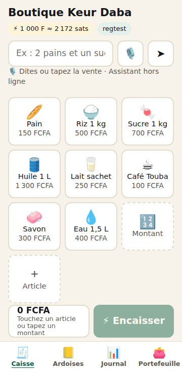
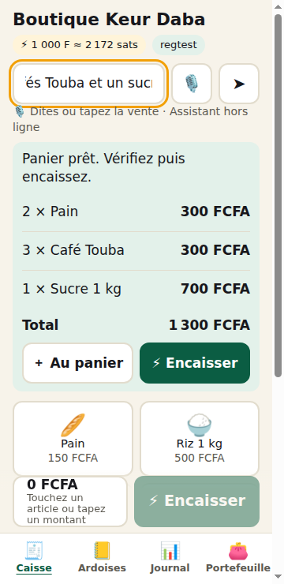
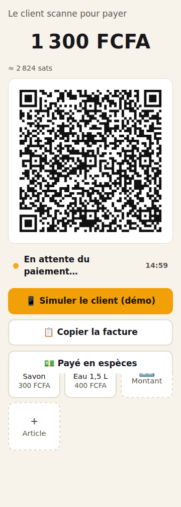
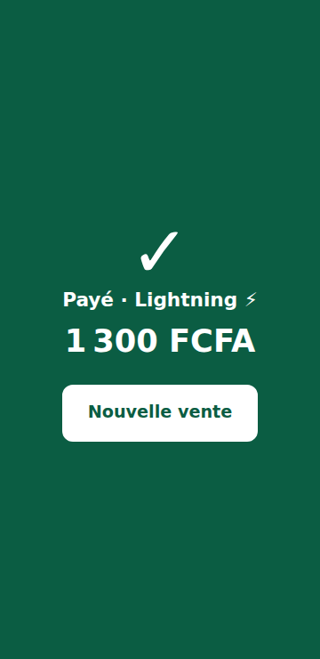
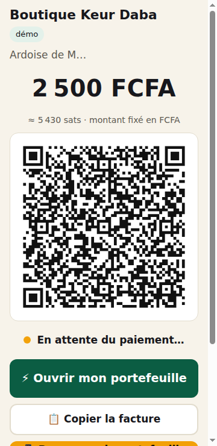
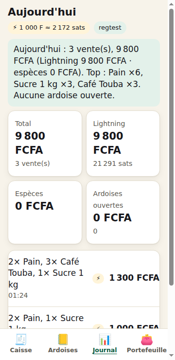
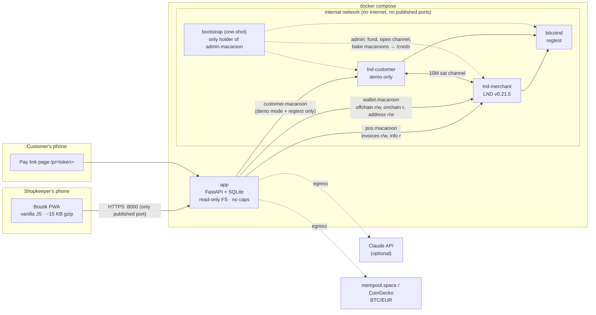

# Boutik ⚡ — the Lightning till and credit notebook for Dakar's corner shops

Boutik lets a *boutiquier* take Lightning payments priced in FCFA, keep the paper *cahier de crédit* on the phone, and send a customer a link to settle their tab, all from a ~15 KB web app that runs on a mid-range Android over 3G.

- **Live demo:** https://boutik-demo.santiago-918.workers.dev (demo PIN `1234`, regtest coins with zero value; first visit after idle wakes the node in ~30 s)
- **Video (3 min):** VIDEO_URL_PLACEHOLDER
- **One-command setup:** `docker compose up --build`, then open http://localhost:8000

| Till | Assistant | Lightning QR | Paid | Customer link | Day summary |
|---|---|---|---|---|---|
|  |  |  |  |  |  |

> Everything runs on a private **regtest** network. No real bitcoin, no real keys, no custody of anyone's money.

---

## The problem

A Dakar neighbourhood *boutique* sells bread, rice, sugar, oil, Café Touba and phone credit all day, in small amounts and mostly in cash.

- **Change is scarce.** A 175 FCFA baguette paid with a 2 000 note often ends in "I'll owe you", a candy instead of coins, or a lost sale.
- **Credit lives on paper.** The *cahier de crédit* is how regular customers buy at the end of the month. The notebook gets lost, gets wet, or the amounts get disputed, and nobody can pay a tab remotely.
- **The diaspora cannot reach the counter.** A relative in Paris or Milan who wants to settle their mother's tab at the corner shop has no direct way to do it.
- **Bitcoin tools speak sats and jargon.** The shopkeeper thinks in FCFA and needs one button, one QR, and one loud "Payé ✓".

## Primary user and how their day changes

**The boutiquier**: one person behind the counter, a mid-range Android phone, intermittent 3G, French as working language, prices in FCFA.

| Today | With Boutik |
|---|---|
| Counts change, runs out of coins | Taps products or says "2 pains et un sucre", shows a QR, hears "Payé ✓" in seconds |
| Writes "Moussa 2 500" in a notebook | Records the ardoise in FCFA and sends Moussa a WhatsApp link |
| Waits for Moussa to come back with cash | Moussa, or his son abroad, pays the link from any Lightning wallet; the ardoise closes itself |
| Adds up the day on paper | Opens *Journal*: total, Lightning vs cash, top items, money still owed |

### Estimated reach (hypotheses to validate, not measured data)

These are planning assumptions, not results from a pilot:

- One shop serves on the order of **100–300 transactions a day** and keeps **10–50 open ardoises**. We will validate both numbers with real shops.
- If 10% of a shop's daily transactions move to Lightning, that is 10–30 change-free sales a day per shop.
- One instance serves one shop; a cooperative or GIE could host several shops on one server (planned, see *Next iteration*).

## What it does

- **Caisse (till)**: product grid with emoji and FCFA prices, free-amount keypad, cart, one-tap "Encaisser". The server converts FCFA to sats (rounded up, so the shop never receives less than the FCFA price) and issues a BOLT11 invoice with a 15-minute expiry.
- **Payment screen**: server-rendered SVG QR, countdown, live status polling with backoff, a full-screen green "Payé ✓" with a chime and vibration, plus "Payé en espèces" for cash.
- **Ardoises (credit notebook)**: record a debt in FCFA with a customer nickname, share a pay link by WhatsApp or copy it. The link issues a **fresh invoice at today's rate when opened**, so the debt stays in FCFA. Cash repayment can be recorded too. A background reconciler marks ardoises paid even when nobody is looking at the screen.
- **Assistant**: "2 pains, 3 cafés Touba et un sucre" becomes a draft cart; "crédit Moussa 2500 pour riz" becomes a draft ardoise; "ventes du jour ?" becomes a spoken-style summary. Voice input via the browser's speech recognition where available.
- **Journal**: today's total, Lightning vs cash split, sats received, top items, open ardoises.
- **Portefeuille (wallet)**: Lightning and on-chain balances in FCFA (sats secondary), inbound capacity, receive on-chain (taproot address), send a Lightning payment behind PIN re-entry and a daily limit.
- **Demo customer wallet** (regtest only): a second real LND node pays any Boutik invoice from a button, so judges can run the whole flow without owning a wallet.

## Quick start

Requirements: Docker with Compose v2. Nothing else.

```bash
git clone https://github.com/S-kkipie/boutik boutik && cd boutik
docker compose up --build
# open http://localhost:8000   ·   demo PIN: 1234
```

The first start builds the app image and pulls `bitcoin/bitcoin:29.5-alpine` and `lightninglabs/lnd:v0.21.5-beta`. The `bootstrap` container then mines regtest blocks, opens a 10 000 000 sat channel from the demo customer to the merchant, bakes least-privilege macaroons and exits (about 7 seconds on a laptop once the images are there). The app starts after bootstrap succeeds.

### Happy path in 5 steps

1. Enter PIN `1234`.
2. On **Caisse**, type `2 pains, 3 cafés Touba et un sucre` and press ➤. Check the draft (1 300 FCFA), tap **⚡ Encaisser**.
3. On the QR screen, tap **📱 Simuler le client (démo)**. The customer node pays over Lightning and the screen turns green: **Payé · Lightning ⚡**.
4. Type `crédit Moussa 2500 pour riz et huile`, tap **📒 Nouvelle ardoise** → **Enregistrer et envoyer**. Tap **👁 Voir la page du client**, then **📱 Payer avec le portefeuille démo** on the customer page.
5. Open **Journal** to see the day's total and the split, then **Portefeuille** → **Créer une facture client démo de 1 000 F** → enter PIN `1234` → **Envoyer un paiement**.

### Automated end-to-end check

`scripts/e2e.sh` runs the same flow against the running stack with real LND nodes:

```text
$ ./scripts/e2e.sh
Boutik e2e → http://localhost:8000
  ✓ app up, Lightning connected
  ✓ login with demo PIN
  ✓ sale 1000 FCFA → 2173 sats invoice
  ✓ customer node paid over Lightning, sale settled
  ✓ ardoise link: fresh invoice, name masked, paid by customer
  ✓ merchant send: wrong PIN refused, right PIN paid
  ✓ summary: Aujourd'hui : 1 vente(s) + 1 ardoise(s) réglée(s), 3 000 FCFA encaissés (Lightning 3 000 FCFA · espèces 0 FCFA). Top : Pain ×2, Sucre 1 kg ×1. Aucune ardoise ouverte.
  ✓ least privilege: POS macaroon cannot spend; app never sees admin.macaroon
All checks passed.
```

The sats figure depends on the live BTC/EUR rate at run time; the summary line grows with every run because it reports the whole day.

Reset everything (chain, channel, sales): `docker compose down -v`.

## Architecture



| Component | Role |
|---|---|
| `app/boutik/main.py` | HTTP API, security middleware, static PWA, background reconciler |
| `app/boutik/service.py` | Payments: create, issue/re-issue invoice, refresh, cash, cancel, summary, outgoing pay |
| `app/boutik/lnd.py` | Minimal async LND REST client, one instance per macaroon |
| `app/boutik/bootstrap.py` | Regtest setup and macaroon baking (separate container) |
| `app/boutik/security.py` | PIN hashing (scrypt), sessions, lockout, rate limiter, CSP and headers |
| `app/boutik/assistant/` | Claude parser + offline French rule parser, shared Pydantic types |
| `app/boutik/rates.py`, `money.py` | BTC/EUR feed with cache and fallback; FCFA ↔ sats via the fixed EUR peg |
| `app/boutik/static/` | PWA: `index.html`, `app.js`, `ui.js`, `pay.html`, `pay.js`, `sw.js`, `app.css` |

Data flow for a sale: PWA posts the cart → server recomputes the total from items → converts FCFA to sats at the cached rate → `pos.macaroon` creates the invoice → PWA shows the QR from `/api/pay/<token>/qr.svg` and polls → server looks up the invoice on LND → `SETTLED` marks the payment paid.

## Wallet implementation

Boutik's wallet is two real LND nodes, not a mock:

- **Nodes**: `lightninglabs/lnd:v0.21.5-beta` with a `bitcoind` 29.5 regtest backend over ZMQ. Wallets are auto-created with `--noseedbackup` (regtest only; see the threat model).
- **Liquidity**: bootstrap mines 101 blocks to the demo customer, opens a **10 000 000 sat** channel customer → merchant with a **300 000 sat push** (so the merchant can demo sending), and sends the merchant 200 000 sats on-chain.
- **Receiving (till)**: the till uses `pos.macaroon`, baked with only `invoices:read`, `invoices:write` and `info:read`. The e2e test proves it gets `permission denied` when it tries to pay.
- **Spending**: `wallet.macaroon` (`offchain:read/write`, `onchain:read`, `address:read/write`, `info:read`) sits behind:
  - PIN re-entry on every payment, even with a valid session;
  - a BOLT11 network-prefix check (`lnbcrt` on regtest), so a mainnet invoice is refused before it reaches LND;
  - decoding the invoice and refusing zero-amount and expired invoices;
  - a **daily send limit of 100 000 FCFA** (`BOUTIK_DAILY_SEND_LIMIT_XOF`), computed from successful sends;
  - a fee cap of `max(10 sats, 1% of the amount)`.
- **On-chain receive**: new taproot address via `/v1/newaddress`.
- **Macaroon custody**: only `bootstrap` mounts the LND data volumes, and it mounts them read-only. The app container mounts only `/creds` (baked macaroons and TLS certs, mode 0400, owned by the app user) read-only.

## AI assistant

- **With `ANTHROPIC_API_KEY` set**: `claude-opus-5-5` (configurable via `BOUTIK_ASSISTANT_MODEL`) is called with a French system prompt, the shop's catalogue, `output_config.effort = "low"` and a strict JSON schema (`intent`, `items`, `customer`, `amount_xof`, `note`, `reply`). The response is re-validated with Pydantic.
- **Without a key, or if the API fails, times out or returns invalid output**: an offline French rule parser (`assistant/rules.py`) handles number words ("deux", "trois"), plurals and accents, explicit unit prices ("3 pains à 175"), line totals ("2 riz 1100"), free items with a price, credits ("crédit Moussa 2000", "Awa me doit 1 500"), summaries and a plain-language Lightning explanation. 13 unit tests cover it.
- **It can only draft.** The assistant returns a proposal; nothing happens until the shopkeeper taps *Encaisser* or *Enregistrer*, and those go through the normal validated endpoints, which recompute totals server-side. The assistant holds no macaroon and has no tool that moves money.
- Text sent to the assistant is never logged. Requests are rate-limited (20 per minute).

## Low bandwidth and UX

- **≈15 KB gzipped first load**: `index.html` 1.5 KB, `app.js` 8.5 KB, `ui.js` 2.4 KB, `app.css` 2.7 KB. No framework, no build step, no web fonts (system fonts), no image assets beyond icons; product pictures are emoji rendered by the phone.
- **QR codes are rendered server-side as SVG** (~1–2 KB), so there is no QR library on the phone.
- **Service worker**: network-first with a 4-second fallback to the cached shell, so the till opens on a weak connection or offline, while a fresh deploy is picked up as soon as the network answers. API calls are never cached.
- **Offline banner** when the phone loses the network; polling backs off from 2 s to 10 s on errors and slows down when the tab is hidden.
- **FCFA everywhere**, sats as secondary information; French grouping (`12 500 FCFA`).
- **Touch targets 52–64 px**, a big numeric keypad, high-contrast warm palette for daylight, dark mode, `prefers-reduced-motion` respected, `aria-live` status for payments.
- **French first, English toggle**; every error message has a plain-language French and English text ("Paiement échoué. Aucun argent n'est parti.").
- **Demo-friendly**: the demo PIN is shown on the login screen in demo mode, and "Simuler le client" buttons appear only in demo mode on regtest.

## Security by design

Summary (details, STRIDE table and residual risks in [THREAT_MODEL.md](THREAT_MODEL.md)):

- Least-privilege macaroons: the till cannot spend; the app never sees `admin.macaroon`.
- Only the app port is published; `bitcoind` and LND sit on an `internal: true` Docker network with no internet access.
- App container: read-only root filesystem, `cap_drop: [ALL]`, `no-new-privileges`, non-root user (uid 10001).
- PIN hashed with scrypt; HttpOnly, `SameSite=Strict` session cookie (Secure by default outside the local demo); session tokens stored hashed; global lockout for 5 minutes after 5 wrong PINs.
- CSRF: every state-changing `/api/` call must carry `X-Boutik: 1`.
- Strict CSP (`default-src 'self'`, no inline script), `X-Frame-Options: DENY`, `nosniff`, `no-referrer`, `Cache-Control: no-store` on the API.
- Pydantic bounds on every amount and label; markup characters rejected in labels; DOM built with `textContent` only.
- No PII or capabilities in logs: uvicorn access log disabled, own log line records the route template (`/api/pay/{token}`), `httpx` request logging silenced so invoices and payment hashes never reach the logs.
- Public pay links: 128-bit random tokens, show only the amount, shop name and the customer's initial; invoice memos never contain the customer's name.
- Rate limits on login, setup, sales, credits, pay links, QR, assistant, wallet and demo endpoints. `X-Forwarded-For` is trusted only from `FORWARDED_ALLOW_IPS` (default `127.0.0.1`), so clients cannot spoof their IP past the limits.
- `Strict-Transport-Security` is sent whenever cookies are `Secure` (HTTPS deployments).

## Configuration

Set in the environment or a `.env` file next to `docker-compose.yml`.

| Variable | Default (compose) | Meaning |
|---|---|---|
| `BOUTIK_PORT` | `8000` | Host port for the app |
| `BOUTIK_DEMO_MODE` | `true` | Seeds the product catalogue, shows the PIN hint, enables the demo customer wallet (regtest only) |
| `BOUTIK_SHOP_NAME` | `Boutique Keur Daba` | Shop name shown in the app and on pay links |
| `BOUTIK_PIN` | `1234` | Initial PIN. Leave empty to have the app ask the merchant to create one |
| `BOUTIK_PUBLIC_URL` | empty | Base URL used in shared pay links; empty = taken from the request (so a phone on the LAN gets a working link) |
| `BOUTIK_COOKIE_SECURE` | `false` | Set `true` behind HTTPS (the app's own default is `true`) |
| `BOUTIK_RATE_SOURCE` | `auto` | `auto` = mempool.space then CoinGecko with fallback; `fixed` = never call out |
| `ANTHROPIC_API_KEY` | empty | Enables the Claude assistant; empty = offline parser |
| `BOUTIK_ASSISTANT_MODEL` | `claude-opus-5-5` | Claude model id |
| `BOUTIK_DAILY_SEND_LIMIT_XOF` | `100000` | Maximum FCFA the wallet may send per day |
| `BITCOIN_RPC_USER` / `BITCOIN_RPC_PASSWORD` | regtest defaults | bitcoind RPC credentials (internal network only) |

Other guard rails live in `app/boutik/config.py` (`BOUTIK_MAX_INVOICE_XOF`, `BOUTIK_SALE_INVOICE_EXPIRY_S`, `BOUTIK_FALLBACK_EUR_PER_BTC`, …); to change them, add the variable to the `app` service's `environment` in `docker-compose.yml`.

## Public demo deployment

The live demo runs the same code on **Cloudflare Containers** (`deploy/`):

- `deploy/Dockerfile.allinone` packs bitcoind (regtest), two LND nodes, bootstrap and the app into one image; `deploy/run-all.sh` supervises them. It keeps the compose trust split: bitcoind, LND and bootstrap run as root with LND directories at mode 0700, while the app runs as uid 10001 via `su-exec` and can read only the baked macaroons (`cat admin.macaroon` as the app user → `Permission denied`). The bitcoind RPC password is random per boot and RPC/LND listen on 127.0.0.1 only.
- `deploy/cloudflare/src/index.ts` is a Worker that forwards every request to one container instance and **overwrites `X-Forwarded-For` with `CF-Connecting-IP`**, so the app's per-IP rate limits cannot be bypassed. While the instance wakes it serves a small "Boutik démarre…" page; the PWA shows "Lightning démarre…" until the nodes are funded.
- The instance sleeps after 30 minutes idle. Its disk is ephemeral, so each wake starts a fresh regtest chain with demo data: judges always get a clean shop.
- Deploy: `cd deploy/cloudflare && npm install && npx wrangler deploy` (needs a Workers Paid account and Docker). `E2E_SKIP_DOCKER=1 ./scripts/e2e.sh https://<your-worker>.workers.dev` runs the happy path against it.

## Constraints and honest limitations

- **Regtest only.** The coins have no value. Signet/mutinynet is the next step; the code already checks invoices against the configured network prefix.
- **One shop per instance.** The shop owns its node and its data. There is no multi-tenant mode.
- **The merchant runs a node.** Today it is a server (or a cooperative's server) plus a phone PWA, not a phone-only wallet.
- **Voice input uses the browser's speech recognition**, which on Chrome sends audio to the browser vendor's service. It is optional; typing works the same.
- **No Wolof yet.** Doing it properly needs native speakers; we did not want to ship guessed translations.
- **The rate is a reference rate** (BTC/EUR from public APIs converted at the fixed 655.957 XOF/EUR peg), cached for 10 minutes, with a fixed fallback when offline.
- **Single PIN, single operator**; the rate limiter and lockout are in memory and reset on restart.
- The app does not terminate TLS itself; put it behind a reverse proxy with HTTPS in any shared deployment.

## Metrics to track

| Metric | Why |
|---|---|
| Time from "Encaisser" to "Payé" (median, p90) | Must beat counting change |
| Share of sales paid by Lightning vs cash | Adoption |
| Ardoises repaid within 7 days | Does the pay link actually get tabs paid? |
| FCFA outstanding on open ardoises | Credit risk the shop carries |
| Failed or expired payment rate | Reliability on real networks |
| First-load bytes and time on 3G | Keeps the app usable on cheap data plans |

## Next iteration

1. **Signet / mutinynet** deployment with a public faucet flow.
2. **Non-custodial mobile wallet** for the shop via an LSP (Breez SDK or LDK Node), so no server is needed.
3. **Mobile-money off-ramp** through a licensed partner, so the shop can turn Lightning receipts into mobile money (no partner is integrated today).
4. **Wolof voice and UI** built with native speakers.
5. **NWC (Nostr Wallet Connect)** so the till can connect to the shop's own wallet.
6. **Multi-shop** for cooperatives and GIE, each shop with its own keys.
7. **Nostr receipts** the customer can keep.

## Tests

```bash
cd app
pip install -e '.[dev]'
pytest          # 27 tests: rule parser, API flows, security checks (fake LND)
```

`./scripts/e2e.sh` (see above) runs the happy path against the real compose stack.

## Project layout

```text
.
├── docker-compose.yml          # bitcoind + 2 × LND + bootstrap + app
├── app/
│   ├── Dockerfile              # python:3.12-slim, non-root, healthcheck
│   ├── pyproject.toml
│   ├── boutik/
│   │   ├── main.py             # API, middleware, static PWA, reconciler
│   │   ├── service.py          # payment logic
│   │   ├── lnd.py              # LND REST client
│   │   ├── bootstrap.py        # regtest setup + macaroon baking
│   │   ├── security.py         # PIN, sessions, lockout, rate limit, CSP
│   │   ├── rates.py  money.py  # BTC/EUR feed, FCFA ↔ sats
│   │   ├── db.py  qr.py  config.py
│   │   ├── assistant/          # claude.py, rules.py, types.py
│   │   └── static/             # PWA (index, app.js, ui.js, pay.*, sw.js, css, icons)
│   └── tests/                  # test_api.py, test_rules.py
├── deploy/                     # single-container image + Cloudflare Worker for the public demo
├── scripts/e2e.sh              # end-to-end check against the stack
├── docs/                       # pitch script, submission text, checklist, slides, screenshots
├── THREAT_MODEL.md
└── SECURITY.md
```

## License

MIT, see [LICENSE](LICENSE).

---

Built for the **Dakar Bitcoin Hack 2026 by BTrust**.
